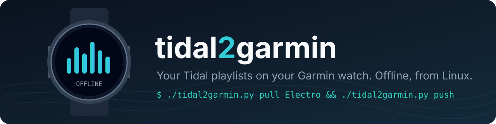

# tidal2garmin

Put your Tidal playlists on a Garmin watch, offline, from Linux.

Tidal has no Garmin app, and Garmin Express does not exist on Linux. `tidal2garmin` downloads the
playlists you choose as tagged AAC files and syncs them to the watch over USB, playlists included.

- One script, no install step: [`uv`](https://docs.astral.sh/uv/) pulls Python and dependencies on first run.
- Tidal "HIGH" quality (AAC 320 kbit/s, `.m4a`): plays natively on the watch, no transcoding, no ffmpeg.
- Tags and cover art are written into every file.
- Incremental: only new tracks are downloaded and copied; tracks removed from a playlist are removed from the watch.
- Checks free space on the watch before copying and refuses if it would not fit (200 MB reserve).
- Only touches files it created (`Music/T<id>.m4a`, its `.m3u` playlists). Your other music stays put.

Tested on a fēnix 7 Pro with Debian/KDE. Other Garmin watches with music storage should work the same way.

## Requirements

- A paid Tidal subscription.
- A Garmin watch with music storage.
- [`uv`](https://docs.astral.sh/uv/getting-started/installation/).
- For `push` (Linux): `gio` with gvfs MTP support (`gvfs-backends`, `gvfs-fuse` on Debian/Ubuntu).

## Usage

```sh
./tidal2garmin.py login        # once; confirm the link in your browser
./tidal2garmin.py pull Electro # download a playlist by name
./tidal2garmin.py push         # watch plugged in via USB
```

Later, `pull --all` followed by `push` refreshes every playlist you have pulled before.

`pull` takes any of these:

| You pass | Example | Resolves to |
|---|---|---|
| Playlist name (yours or favorited) | `Electro`, `electro` | Exact match first, then substring; asks if ambiguous |
| Playlist UUID | `1f3a9c2e-7b41-4d0a-9e55-3c8d2a6b7f10` | Playlist |
| Number | `251380836` | Album |
| Tidal URL | `https://tidal.com/browse/mix/0123abc…` | Playlist, album or mix |

Mixes have no short form, so they need the URL. Run `playlists` to see names and IDs.

| Command | What it does |
|---|---|
| *(none)* / `status` | Login, library and connected watches at a glance |
| `login` | Log in to Tidal (device link), session kept in `~/.config/tidal2garmin/` |
| `playlists` | Your Tidal playlists (own and favorited) with IDs |
| `pull <name\|id\|url>…` / `pull --all` | Download into the local library (`~/Music/tidal-garmin/`) |
| `drop <name>` | Forget a playlist; the next `push` removes it from the watch |
| `push [--dry-run] [--release-kde]` | Mirror the library to the watch's `Music/` folder |
| `list [-s]` | What is on the watch, per playlist |

Set `TIDAL2GARMIN_LIB` to keep the library somewhere else.

## Sample output

Status, with the watch plugged in:

```
$ ./tidal2garmin.py

Tidal
  login     session stored
  library   ~/Music/tidal-garmin · 2 playlists · 213 tracks
  lists     Electro, Trail Running

Watch
  usb       Garmin International 091e:5117 /dev/bus/usb/003/034
  state     MTP · ok (gvfs)
  music     211 synced tracks · 0 other files · playlists: Electro, Trail Running
  space     15.6 GB free of 31.1 GB  ━━━━━━━━━━━━━━━━━━━━━━━━ 50% used

Next push
  copy      2 tracks (21.3 MB)
  delete    0 tracks (0 B)
  after     15.6 GB free
```

Finding and pulling a playlist:

```
$ ./tidal2garmin.py playlists

Your playlists (3)
  1f3a9c2e-7b41-4d0a-9e55-3c8d2a6b7f10    107  Electro
  8c0d5e71-2a9f-4b3c-a1d4-6e2f9b0c4a88    106  Trail Running
  d4b7e2a0-5c6f-41e9-8f13-0a9c7d2e6b55     18  Sunday Morning

$ ./tidal2garmin.py pull electro

  skip Roman Blum - Menekeita (Amount Remix) (no stream (HTTPError))
  Electro (playlist) ━━━━━━━━━━━━━━━━━━━━━━━━━━━━━━━━━━━━━━━━ 107/107 0:00:00
  ✓ Electro: 106 tracks (2 new, 1 skipped)

  library   ~/Music/tidal-garmin

$ ./tidal2garmin.py pull sunday
'sunday' is ambiguous:
  d4b7e2a0-5c6f-41e9-8f13-0a9c7d2e6b55  Sunday Morning
  5e9a1c3b-0d7f-4a26-b8e4-2f6c1a9d3e07  Lazy Sunday
```

Syncing to the watch:

```
$ ./tidal2garmin.py push

Push
  watch     watch:/Internal Storage/Music
  copy      2 tracks (21.3 MB)
  delete    0 tracks (0 B)
  lists     write 2, delete 0
  space     15.6 GB free now, 15.6 GB after (of 31.1 GB)

  copy to watch ━━━━━━━━━━━━━━━━━━━━━━━━━━━━━━━━━━━━━━━━ 2/2 0:00:00 
  ✓ Done. Eject the watch before unplugging (file manager or gio mount -u)
```

What is on the watch:

```
$ ./tidal2garmin.py list

Electro (106 tracks)
    1  DARKSIDE - What They Say
    2  Recondite - Caldera
    3  Fluke - O.K.
    4  Touch Sensitive - Pizza Guy
    5  RJD2 - Since We Last Spoke
  ...

$ ./tidal2garmin.py list -s

Playlists on the watch
    106  Electro
    105  Trail Running
```

## Troubleshooting

**`Watch is held by KDE (kiod6)`**: KDE's MTP service grabs the watch as soon as it is plugged in,
and MTP allows only one client. `push --release-kde` stops `kiod6` (KDE restarts it on demand) so
gvfs can take over. Opening Dolphin on the device afterwards may grab it again.

**`transitional USB mode (091e:0003)`**: The watch briefly shows up as `091e:0003` while it
(re)connects. Wait a few seconds or replug.

**No Garmin on USB at all**: The clip cable is picky. Clean the contacts, plug into a USB port
directly (no hub or dock), and watch `lsusb | grep 091e` while seating the clip.

**A track is skipped with `no stream`**: Tidal won't stream it in your region, or it was pulled
from the catalogue. Nothing to fix on this side.

## macOS and Windows

`login`, `playlists` and `pull` should work there too (untested). `push` is Linux-only; use Garmin
Express instead and add the library folder (`~/Music/tidal-garmin/tracks`) as a music source.
Playlists are only generated by `push` so far, so with Garmin Express you get the tracks without
the playlists.

## How it works

- Tidal access goes through [`tidalapi`](https://github.com/tamland/python-tidal) using the
  regular device login.
- "HIGH" quality is delivered as a single, unencrypted `.m4a` file. It is saved as-is and tagged
  with [`mutagen`](https://github.com/quodlibet/mutagen). Encrypted streams are skipped, never
  decrypted.
- Files are named after the Tidal track ID (`T<id>.m4a`), so a track that appears in several
  playlists exists once on the watch.
- Playlists are bare `.m3u` files next to the tracks in `Music/`. The watch rewrites them on import
  (`0:/MUSIC/T…M4A`), which is how you can tell it picked them up.
- Copying goes through gvfs (`gio copy`); copying via libmtp has been reported to produce empty
  files on Garmin watches.

## Disclaimer

For personal use with your own paid Tidal subscription. This tool does not circumvent DRM, but
storing tracks outside the Tidal app may violate Tidal's terms of service. Use at your own risk.
Not affiliated with Tidal or Garmin.
